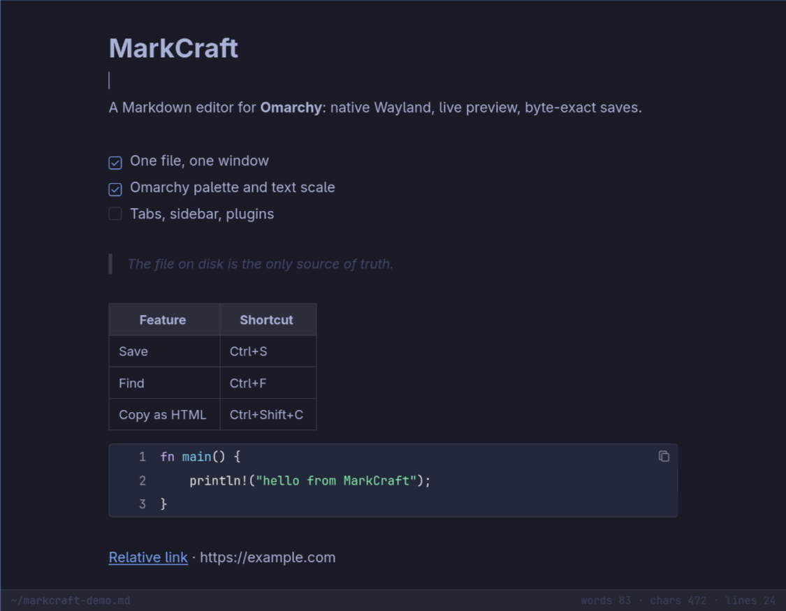

# MarkCraft

[Русский](README.ru.md) | English

MarkCraft is a Markdown editor built for Omarchy. It opens one file in a native Wayland window (GTK3 + WebKitGTK), renders GitHub-flavored Markdown as you type, and writes the file back byte for byte. There is no vault, no database, no Electron, and no settings screen: the palette comes from Omarchy, the font from the system, and the file on disk is the only source of truth.

> Built primarily for Omarchy, and deliberately in its spirit: a small native app, system theme and fonts, no in-app settings, no background daemon, no network assets.

- **Byte-exact saves.** CRLF, BOM, tabs, trailing spaces, a missing final newline and Unicode survive a round trip. The fixture suite reopens each file and compares the bytes; the release checklist also saves every fixture without edits and runs `cmp`.
- **Text, not an AST.** Editing changes the Markdown source directly; there is no AST-to-Markdown serializer that could reformat the file.
- **Omarchy-native.** Reads the current palette from `$XDG_STATE_HOME/omarchy/current/theme/colors.toml` (usually `~/.local/state/…`), repaints live when `omarchy theme set` switches the theme, themes GTK dialogs too, follows the desktop text scale, and ships a `.desktop` entry, an icon and an Arch PKGBUILD.
- **Live GFM preview on CodeMirror 6.** Inkdown metrics: 16 px base, 700 px text column, system sans and mono. Markdown markers appear only in the line you are editing. Fenced code gets 13 languages, line numbers and a copy button; YAML front matter is rendered as a code block.
- **Edits survive a crash.** Autosave runs on a 1.2 s timer for files with a path (a recovered draft waits for an explicit Ctrl+S); a draft is written on a 300 ms timer and survives `kill -9`. External writes are detected by polling `mtime` and size every 700 ms, with “reload” / “keep mine” dialogs. Saves go through a temp file and `rename`, permissions are preserved, and read-only files are refused.
- **One process, many windows.** Ctrl+N opens a new window in the same process; opening an already open file focuses its window. Relative Markdown/text links (`*.md`, `*.markdown`, `*.txt`) open in MarkCraft, external URLs in the system browser.
- **One binary, no network assets.** CSS and JS are embedded in the Rust executable; GTK3 and WebKitGTK come from the system. No CDN, telemetry or update checks.
- **13 highlighting languages:** Rust, Python, JavaScript/TypeScript, JSON, Shell, YAML, TOML, SQL, Go, C, C++, CSS, XML/HTML.
- **EN/RU UI** from `LANGUAGE` / `LC_ALL` / `LC_MESSAGES` / `LANG`, read once at startup. Anything other than Russian falls back to English.
- **Status bar and HTML copy.** Path shortened to `~` plus word, character and line counts; Ctrl+Shift+C puts rendered HTML and plain-text Markdown on the clipboard.



*Live GFM preview, the Omarchy palette, code highlighting and the status bar.*

**Contents:** [Example](#example) · [Install](#install) · [Built for Omarchy](#built-for-omarchy) · [Keys](#keys) · [Architecture](#architecture) · [Environment](#environment-variables-and-state) · [Tests](#tests) · [Known limits](#known-limits) · [Documentation](#documentation) · [License](#license)

---

## Example

```sh
markcraft                  # empty window
markcraft notes.md         # open a file
markcraft --help           # usage
markcraft --version        # version
```

A document MarkCraft handles well:

```md
# Release 0.1

- [x] Byte-exact save
- [ ] Tables with alignment

| Key | Action |
| --- | ------ |
| `Ctrl+S` | Save |
```

MarkCraft renders this live, with Markdown markers visible only in the line you are editing. Press Ctrl+S and the file on disk is exactly what you typed.

---

## Install

MarkCraft needs Linux, GTK3, WebKitGTK 4.1 and `xdg-desktop-portal` at runtime. On Omarchy or Arch, install it with one command:

```sh
curl -fsSL https://raw.githubusercontent.com/CryptoMiron/markcraft/master/bin/install | bash
```

The script asks for your sudo password, installs the missing build tools, builds an Arch package from the latest `master` and installs it with `pacman`. After that `pacman -Q markcraft` finds the package, the launcher entry and icon are in place, and `sudo pacman -R markcraft` removes everything. Run the same command again to update.

The package is built from source, so the first install needs network access and a few minutes. Rust, Bun and Python are installed as build dependencies; GTK3, WebKitGTK 4.1 and `xdg-desktop-portal` come with the package. The script is [`bin/install`](bin/install): read it before piping it into a shell.

### From source

To run a checkout without installing:

```sh
sudo pacman -S --needed base-devel rust gtk3 webkit2gtk-4.1 xdg-desktop-portal
git clone https://github.com/CryptoMiron/markcraft.git
cd markcraft
cargo build --release --locked
./target/release/markcraft README.md
```

`ui/built.html` is committed, so this build does not need Bun.

To change the UI, install the bundling tools and rebuild the page:

```sh
sudo pacman -S --needed bun python3
bun install --frozen-lockfile
bin/bundle
cargo build --release --locked
```

After editing `ui/*.js` or `ui/*.css`, always run `bin/bundle`: `bin/check` fails if `ui/built.html` is stale.

Run the full check:

```sh
./bin/check
```

To build and install the package from a checkout without the script:

```sh
cd pkgbuild
makepkg -fsi
```

`makepkg` rebuilds the embedded UI through `bin/bundle` (Bun + Python 3) and installs the binary, `.desktop` entry and hicolor icon.

---

## Built for Omarchy

MarkCraft was built primarily as an Omarchy app. It does not bring its own theme engine or settings panel; it reads what Omarchy and the desktop already provide and gets out of the way.

| What | Where it comes from |
| --- | --- |
| Palette | `$XDG_STATE_HOME/omarchy/current/theme/colors.toml` (normally `~/.local/state/omarchy/current/theme/colors.toml`) |
| Light/dark | `mode` from the same file, or the background luminance when `mode` is missing |
| Text size | `org.gnome.desktop.interface text-scaling-factor` through the XDG desktop portal, clamped to 0.5–3.0 |
| Live theme switch | `gio::FileMonitor` on `omarchy/current` and `omarchy/current/theme` |
| Dialogs | A GTK CSS provider uses the same palette, so native dialogs do not fall back to Adwaita |
| Launcher | `.desktop` entry with `MimeType=text/markdown;text/x-markdown;text/plain`, hicolor icon |
| Tiling | Works in Hyprland; shrinks to 280×200 without horizontal scrolling |

Try it on a live window:

```sh
omarchy theme set tokyo-night
omarchy theme set catppuccin-latte
```

The open window repaints without a restart. The fullscreen key stays Omarchy's own (`Meta+F`); MarkCraft does not capture it.

---

## Keys

| Keys | Action |
| --- | --- |
| `Ctrl+O` / `Ctrl+S` / `Ctrl+Shift+S` | Open / save / save as |
| `Ctrl+N` | New window in the same process |
| `Ctrl+Z` / `Ctrl+Shift+Z` / `Ctrl+Y` | Undo / redo |
| `Ctrl+B` / `Ctrl+I` / `Ctrl+Shift+X` | Bold / italic / strikethrough |
| `Ctrl+K` | Link; inside an existing link it selects the URL |
| `Ctrl+F` / `Ctrl+H` | Find / find and replace |
| `Enter` / `Ctrl+G` / `Shift+Enter` / `Esc` | Next / next / previous / close search |
| `Ctrl+=` / `Ctrl+-` / `Ctrl+0` / `Ctrl+wheel` | Text size |
| `Ctrl+Shift+C` | Copy the document as HTML plus plain-text Markdown |
| `Ctrl+?` / `Ctrl+/` / `F1` | Key help |
| `Ctrl+click` a link | Relative file in MarkCraft, `#anchor` in the current document, external URL in the system browser |
| `Enter` in a list | Continue the list, task or quote; an empty item exits the list |
| `Tab` / `Shift+Tab` | Indent / outdent a list item |

---

## Architecture

MarkCraft is a Rust GTK3 host with a WebKitGTK WebView. Rust owns the file, the disk state and the system integration; the WebView owns editing, rendering and the status bar.

```text
GApplication (one process, many windows)
└── ApplicationWindow
    └── WebKitGTK WebView
        └── CodeMirror 6: editing, live preview, search

Rust:
├── Doc: bytes, autosave, draft, disk conflicts
├── Theme: colors.toml, GTK CSS, theme monitors
└── i18n: en/ru, dialogs, clipboard, links
```

| Path | Responsibility |
| --- | --- |
| `src/main.rs` | GApplication, windows, IPC, autosave, draft timers, disk watcher, dialogs, clipboard, link handling |
| `src/doc.rs` | Byte-exact `Doc`, CRLF/BOM handling, atomic save, crash draft, window geometry |
| `src/theme.rs` | Omarchy `colors.toml` parser, CSS variables, GTK dialog CSS, portal text scale, theme monitors |
| `src/i18n.rs`, `src/locales/` | Language selection and the en/ru dictionaries |
| `ui/editor.js` | CodeMirror 6 editor, live-preview decorations, search, key routing, `window.mc` bridge |
| `ui/*.test.js` | Bun tests for pure UI rules: hotkeys, editing, links, frontmatter, code blocks, history, search |
| `ui/built.html` | Single-page UI embedded into the binary; committed so `cargo build` works without Bun |
| `fixtures/` | Byte-exact round-trip corpus: CRLF, BOM, tabs, no final newline, front matter, GFM, code languages |
| `docs/` | Requirements, typography, process, cuts and the decision log |
| `pkgbuild/` | Arch package, `.desktop` entry and icon |

**Data flow**

- **Load:** bytes → UTF-8 validation → remember EOL and BOM → LF text in memory → `window.mc.loaded` (no undo entry).
- **Edit:** CodeMirror sends `dirty` with the full text; Rust updates `Doc`, then schedules the draft (300 ms) and autosave (1.2 s).
- **Save:** bytes are rebuilt with the original EOL and BOM, written to `.markcraft-tmp`, permissions are copied, then the temp file is renamed over the target.
- **External change:** an `mtime` + size stamp is polled every 700 ms. Without local edits the file is reloaded silently; with local edits you get “reload” / “keep mine”; a deleted file gets “save again” / “keep as is”.
- **Theme:** a small built-in `colors.toml` parser (no TOML dependency) emits one `:root{…}` rule; GTK dialog CSS is kept in sync.

**Build pipeline**

```text
ui/template.html + ui/style.css + ui/*.js
        │ bun build (bin/bundle)
        ▼
ui/editor.bundle.js  →  ui/built.html (committed)
        │ include_str!
        ▼
Rust binary
```

Rust injects the selected en/ru dictionary into the page before the editor bundle runs. There is no async runtime and no background service: one GApplication process and one GTK main loop own all windows.

The host is written directly on `gtk-rs` + `webkit2gtk-rs` because wry's Linux backend supported only X11 at the time; MarkCraft is a native Wayland app. The decision is recorded in [`docs/CUTS.md`](docs/CUTS.md).

---

## Environment variables and state

| Variable | Used for |
| --- | --- |
| `XDG_STATE_HOME` | Base for MarkCraft state and the Omarchy theme path. Defaults to `$HOME/.local/state`. |
| `HOME` | Fallback when `XDG_STATE_HOME` is unset; also used to shorten paths to `~` in the status bar. |
| `LANGUAGE`, `LC_ALL`, `LC_MESSAGES`, `LANG` | UI language, checked in that order. `ru` selects Russian; everything else selects English. Read once per process. |
| `MC_DEBUG` | When set, prints the generated theme CSS to stderr. |

State files under `$XDG_STATE_HOME/markcraft/`:

| File | Contents |
| --- | --- |
| `draft` | Shared crash draft (JSON `{path, text}`); restored on the next launch |
| `zoom` | Text zoom multiplier |
| `window` | Last window width and height; position is left to the Wayland compositor |

Examples:

```sh
XDG_STATE_HOME=/tmp/mc-state ./target/release/markcraft README.md
LANGUAGE=ru ./target/release/markcraft README.md
```

---

## Tests

```sh
./bin/check
```

The script runs:

- `cargo fmt --check`
- `cargo clippy --all-targets -- -D warnings`
- `cargo test` — currently 29 Rust tests: byte-exact round trip over `fixtures/`, save, CRLF/BOM, draft, disk state, theme parsing and clamping, theme CSS, link resolution, i18n
- `bun test ui/` — currently 71 UI tests: hotkeys by physical key, editing rules, link parsing, frontmatter, code-block boundaries, search and `replaceAll`, history
- `bin/bundle`, then fails if `ui/built.html` changed

Rendering is checked by eye, not by golden HTML: a golden-HTML test would need updating on every refactor and would fail on a font change. The manual checklist lives in [`docs/PROCESS.md`](docs/PROCESS.md).

Before closing a release, open every fixture and save it without edits; `cmp` must be clean.

---

## Known limits

- No vault, note database, tags or wiki links. One window is one document; there are no tabs, sidebar or split panes.
- No KaTeX, Mermaid, PDF/DOCX/HTML file export, plugins, sync, git integration, chat or LLM features.
- Live preview is a decoration layer over Markdown, not block WYSIWYG: no drag handles or slash menu.
- WebKitGTK costs roughly 100 MB RSS. That is the price of a complete layout engine without Electron.
- Text scaling is read at launch and when the theme changes; the portal signal is not watched live.
- Fullscreen is left to Omarchy.
- A hard kill can lose up to 300 ms of the last typing. The crash draft is one shared `draft` file, not one per window.

---

## Documentation

- [`docs/SPEC.md`](docs/SPEC.md) — the requirement list, R1.1…R5.6
- [`docs/TYPOGRAPHY.md`](docs/TYPOGRAPHY.md) — Inkdown layout numbers
- [`docs/PROCESS.md`](docs/PROCESS.md) — how the project is built and checked
- [`docs/CUTS.md`](docs/CUTS.md) — deliberate non-goals and known ceilings
- [`docs/DECISIONS.md`](docs/DECISIONS.md) — decision log
- `docs/S*.md` — notes for each implementation slice

---

## License

MIT. See [`LICENSE`](LICENSE).

Layout numbers were measured from Inkdown (AGPL-3.0), but no code was copied: MarkCraft is an independent CodeMirror 6 implementation. Not affiliated with the Inkdown project.

Copyright (c) 2026 MarkCraft contributors.
